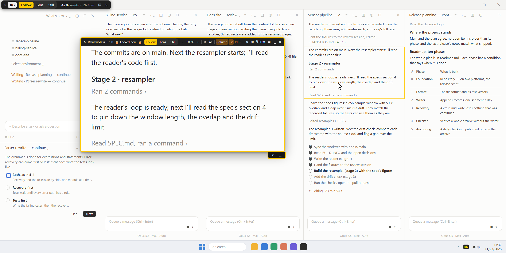

# ReviewGlass

**A magnifier and live diff for Claude Code on Windows.** Five sessions side by side
leave each pane a few hundred pixels wide, and the app's own zoom does not go far.
ReviewGlass reads the pane you click at 150–400 %, shows every running session and the
account's quota in one strip, and shows what the agent just changed as a live diff.



<sub>A drawn picture with invented content, laid out from a photograph of the author's
screen. The glass keeps itself out of every screenshot, so a capture would show
everything but the glass. Source: [`docs/media/hero.html`](docs/media/hero.html).</sub>

A Windows 11 desktop companion built with Tauri v2, a Rust core and SvelteKit. It reads
only files Claude Code already writes on your machine. Nothing leaves the machine
unless you turn on Explain with a remote backend and send a hunk yourself.

> ReviewGlass is an independent project. It is not made, endorsed or supported by
> Anthropic. "Claude" and "Claude Code" are Anthropic's names for their products; this
> tool only reads files Claude Code already writes on your own machine.

**Status: pre-alpha.** It is in daily use by its author. The installer and the release
workflow are built (P7); the first release is not out yet. The phases built so far are
the magnifier (P1), the session panel (P2), threshold alerts (P3), the live diff with a
whole-file view (P4, P4b), the glass locked to a pane (P4c) and a provider-agnostic
explain feature (P6, off by default). Next is the glass in other applications (P9). The
name is kept (ADR-0008, 13 November 2026); the research behind it is in
[`docs/NAME-CLEARANCE.md`](docs/NAME-CLEARANCE.md). The source has been public since 17 September 2026. Where the build
stands: [`docs/BUILD_INFO.json`](docs/BUILD_INFO.json); what shipped and why:
[`docs/CHANGELOG.md`](docs/CHANGELOG.md).

## What it does

Reading an agent's output in a narrow pane, several sessions side by side, is small text
that keeps moving. ReviewGlass adds four things the Claude desktop app does not have:

1. **The glass**: an always-on-top magnifier (150–400 %, pixels only, no OCR).
   - **Follow**: the glass stays put and shows what is around the cursor. A halo marks
     the cursor on the screen.
   - **Click-lock to a pane**: a click on a Code pane locks the glass to that pane, as
     the app's own UI Automation tree reports it. The glass then reads only that pane,
     at the pane's width times the zoom. The arrow keys step the lock to the
     neighbouring pane, and a window of another application over the pane pauses the
     picture.
   - **Lock here**: a button on the glass's bar keeps the glass where you put it, across
     pane changes and restarts, until you press the open lock beside it. The glass then
     only widens or narrows around its centre, so its reading area runs along the
     locked pane's edges.
   - **Lens**: the glass rides on the cursor.
   - **Still**: the picture stops, so an instruction you captured survives while you
     work elsewhere.
2. **The dock and its drawer**: a small always-on-top strip with the quota gauge and the
   glass's switches. Its drawer is the panel.
   - **Sessions**: every running session in one table, whether it runs in a Desktop tab
     or a terminal.
   - **Quota**: the account-wide 5-hour and 7-day quota, with the burn rate and a
     Windows notification before a threshold you set.
   - **Diff**: the agent's edits as a live `git diff` per changed file, grouped by
     session, with the whole file around a hunk and the latest edit's lines highlighted.
     For a session with no edit in the last hour, such as one waiting on a timer, it
     shows the project's uncommitted changes instead and says so.
3. **The diff window**: the locked pane's session's diff in its own frameless window,
   beside the pane. Open it from the glass's bar or with `Ctrl+Alt+D`.
4. **Explain** (off by default): a plain-language explanation of one selected diff
   hunk. The backend is yours to choose: a local model on `127.0.0.1` or a remote API
   with your own key.

A tray icon keeps the app findable when every window is hidden, and a second launch
brings the running copy's dock forward instead of starting another.

## Requirements

- Windows 11 (Windows.Graphics.Capture, WebView2 and UI Automation are used directly).
- Claude Code: the Claude desktop app's Code tab, the terminal `claude` CLI, or both.
- To build: Rust (stable, MSVC), Node 22+, pnpm, Visual Studio Build Tools with the
  Windows 10/11 SDK. The WebView2 runtime comes with Windows 11.

## Installing

Releases are published on [GitHub Releases](https://github.com/Sunrisesoftware-app/reviewglass/releases)
(the first one is not out yet; until then, build from source below).

1. Download `ReviewGlass_<version>_x64-setup.exe` and run it. It installs for your user
   only, with no administrator rights. Windows SmartScreen may call it unrecognised,
   because it is not code-signed yet; the release page gives its SHA-256.
2. ReviewGlass starts with its dock in a screen corner, and on the first start the
   dock's drawer opens on **Settings > Claude Code**.
3. Press **Connect**. It first shows what it will do: copy two small collectors to
   `~/.reviewglass/bin`, keep your Claude Code settings as
   `settings.json.bak-reviewglass`, and add a status line and an after-edit hook to
   `~/.claude/settings.json`, leaving everything else in it as it is. If you have a
   status line of your own, you choose whether it stays on screen (ReviewGlass runs it)
   or ReviewGlass's replaces it. **Disconnect** in the same place takes it all back.

**Upgrading:** run a newer installer over the installed one. The connection stays.
ReviewGlass never checks for updates itself (ADR-0037); Settings > About shows your
version and opens the releases page. A winget package will follow the first release.

**Uninstalling:** Windows Settings > Apps. The uninstaller removes ReviewGlass's entries
from your Claude Code settings, puts your own status line back and removes the
collectors; `~/.reviewglass` keeps only its logs and the spool.

## Building from source

```bash
pnpm install
pnpm tauri build
```

This builds the app, `src-tauri/target/release/reviewglass.exe`, the two collectors
beside it (`reviewglass-statusline.exe`, `reviewglass-hook.exe`) and the installer,
`src-tauri/target/release/bundle/nsis/ReviewGlass_<version>_x64-setup.exe`. Run the
installer, or start `reviewglass.exe` where it was built and press **Connect** in
Settings > Claude Code, which copies the collectors from beside it. By hand instead, copy
the two collectors to `~/.reviewglass/bin/` and merge this into
`~/.claude/settings.json`, with forward slashes in the paths:

```json
{
  "statusLine": {
    "type": "command",
    "command": "C:/Users/<you>/.reviewglass/bin/reviewglass-statusline.exe"
  },
  "hooks": {
    "PostToolUse": [
      {
        "matcher": "Edit|Write|MultiEdit|NotebookEdit",
        "hooks": [
          {
            "type": "command",
            "command": "C:/Users/<you>/.reviewglass/bin/reviewglass-hook.exe",
            "timeout": 5
          }
        ]
      }
    ]
  }
}
```

A release is a tag: `pnpm version:set <version>`, commit, push, then
`git tag v<version>` and push the tag. The release workflow checks that the tag is the
version, runs every check CI runs, builds the installer and makes a draft release with
the installer, its SHA-256 and winget's manifests; the draft is published by hand.

Keep these in mind when you set it up:

- **One status line.** `statusLine` holds a single command. Connect lets your own stay
  on screen (the collector runs it and reads its figures beside it) or puts
  ReviewGlass's short line in its place; set up by hand, ReviewGlass's replaces yours.
- **A session uses the status line that existed when it started.** Terminal sessions
  that were already running must be restarted before they report. The hook does not
  need a restart.
- **The quota gauge needs a terminal session.** Claude Code runs a status line only in
  the terminal CLI, not in the desktop app's Code tab. With the desktop app alone you
  still see every session and the live diff, and the panel says why the gauge is empty.
- The collectors always exit 0 and never write into a session. If ReviewGlass is not
  running, they cost a few milliseconds and leave a few small files; edit events are
  pruned after an hour.

For a development build with hot reload, run `pnpm tauri dev`. `pnpm tauri build` also
produces an NSIS `-setup.exe` and an MSI (the MSI needs the VBSCRIPT optional Windows
feature). These packages are unsigned and do not yet set up the collectors.

## Keys

| Key | What it does |
|---|---|
| `Ctrl+Alt+G` | Show or hide the glass (changeable in Settings) |
| `Ctrl+Alt+F` | Still: freeze the picture, or let it go |
| `Ctrl+Alt+L` | Lens on or off |
| `Ctrl+Alt+←` / `→` | Move the lock to the neighbouring pane (plain `←` / `→` while the glass has the focus) |
| `Ctrl+Alt+D` | Open or close the diff window |
| `Esc` (in the glass) | Hide the glass |

Every key has a mouse equivalent as well: a button on the glass's bar or the dock, an item
in the right-click menu, or, for the arrows, a click on another pane.

## What runs on your machine

So you can tell ReviewGlass's processes from everything else in Task Manager:

| Process | What it is | How to recognise it |
|---|---|---|
| `reviewglass.exe` | The app, always exactly one (a second launch only brings the dock forward) | Its windows: ReviewGlass Glass, Dock, Halo, Finder, Diff, and ReviewGlass (the drawer) |
| `msedgewebview2.exe`, usually 5–9 | The app's windows' web views | Other apps use WebView2 too; ReviewGlass's have `app.sunrisesoftware.reviewglass` in their command line, and the first of them has `reviewglass.exe` as its parent |
| `reviewglass-statusline.exe`, `reviewglass-hook.exe` | The collectors Claude Code runs | Live for milliseconds per run, from `~/.reviewglass/bin` |

The app's identifier is `app.sunrisesoftware.reviewglass`: its web views' data is in
`%LOCALAPPDATA%\app.sunrisesoftware.reviewglass`, everything else under `~/.reviewglass`.

If ReviewGlass stops responding and the tray icon no longer answers either, the Start
Menu entry **Stop ReviewGlass** ends it: `taskkill /IM reviewglass.exe /F /T`, the app
and its web views, which are its children. Until an installer creates that entry (P7),
it is made by hand like the app's own shortcut. The same from a PowerShell prompt,
matching the web views by their identifier as well:

```powershell
Get-CimInstance Win32_Process | Where-Object { $_.Name -like 'reviewglass*' -or ($_.Name -eq 'msedgewebview2.exe' -and $_.CommandLine -match 'app\.sunrisesoftware\.reviewglass') } | ForEach-Object { Stop-Process -Id $_.ProcessId -Force }
```

## Privacy posture

- **Screen pixels are read, scaled and shown, never kept.** The glass and its halo
  exclude themselves from screen capture. The glass's pixels are never written to disk
  or transmitted. The one picture ReviewGlass saves is one you ask for: the drawer's
  camera button copies an image of the drawer's own page (not the screen) to the
  clipboard and to `Pictures\ReviewGlass`.
- **Session data comes from files Claude Code already writes on this machine.** These
  are the spool the two collectors fill and the JSONL transcripts, which are opened
  read-only. The hook records which file an edit touched, never the edit's content.
  Only session state is read from a transcript, never the conversation.
- **Other applications are read for their structure only** (ADR-0032): the kind of
  element under your click, its role, its class and its rectangle. Never names, values
  or text, and never from a password manager. Today this happens only while you run the
  structure recorder in Settings › Measurements, and the result is a local file.
- **ReviewGlass never writes into a session, a repository or a transcript.**
- **Inter-process communication is plain files under your user profile**
  (`~/.reviewglass`). There is no network listener, no localhost port and no IPC socket.
- **There are no analytics and no accounts.** The diagnostic logs (`panic.log`,
  `stall.log`) stay under `~/.reviewglass` and hold timings, sizes and places in the
  code, never pixels or text.
- **Explain is off by default, with no backend selected**, so a fresh installation
  performs no inference.
  - The *local* backend keeps everything on the machine, over loopback.
  - The *remote* backend is the only path on which anything leaves the machine. Each
    send is triggered by you, per hunk, and the exact payload is shown before the
    first one. Only the selected hunk and its immediate context are sent, never the
    file, the repository or the conversation. The key lives in Windows Credential
    Manager.

## Documentation

| | |
|---|---|
| [`docs/REVIEWGLASS-SPEC.md`](docs/REVIEWGLASS-SPEC.md) | The product and architecture specification: the measured facts about Claude Code's surfaces, the module contracts, the roadmap |
| [`docs/adr/`](docs/adr/) | The architecture decisions, one file each |
| [`docs/CHANGELOG.md`](docs/CHANGELOG.md) | What shipped, why, and what was measured, newest first |
| [`docs/LESSONS.md`](docs/LESSONS.md) | Pitfalls met on the way, with the story behind each rule |
| [`docs/BUILD_INFO.json`](docs/BUILD_INFO.json) | Where the build stands and what is next |

## Layout

| Path | What |
|---|---|
| `src-tauri/src/capture/` | Windows.Graphics.Capture, the crop, the pane detector |
| `src-tauri/src/glass.rs`, `frame.rs` | The glass's modes, hotkeys and menus; the click-lock to a pane |
| `src-tauri/src/session/`, `usage.rs` | Session sources (spool and transcripts) and the quota model |
| `src-tauri/src/diff/`, `diffwin.rs` | The live diff and the diff window |
| `src-tauri/src/explain/` | The explain service; `backend/` is the only place a provider is named |
| `src-tauri/src/bin/statusline.rs`, `bin/hook.rs` | The two collectors Claude Code runs |
| `src/routes/glass`, `dock`, `halo`, `finder` | The windows' pages; `src/lib/panel/` holds the drawer's tabs |

## Contributing

This is a single-author project for now. Issues describing what you saw are welcome.
Pull requests are best discussed in an issue first, because the design decisions are
kept in the ADRs and a change that crosses one needs a new decision.

## License

Apache-2.0. See [`LICENSE`](LICENSE).
